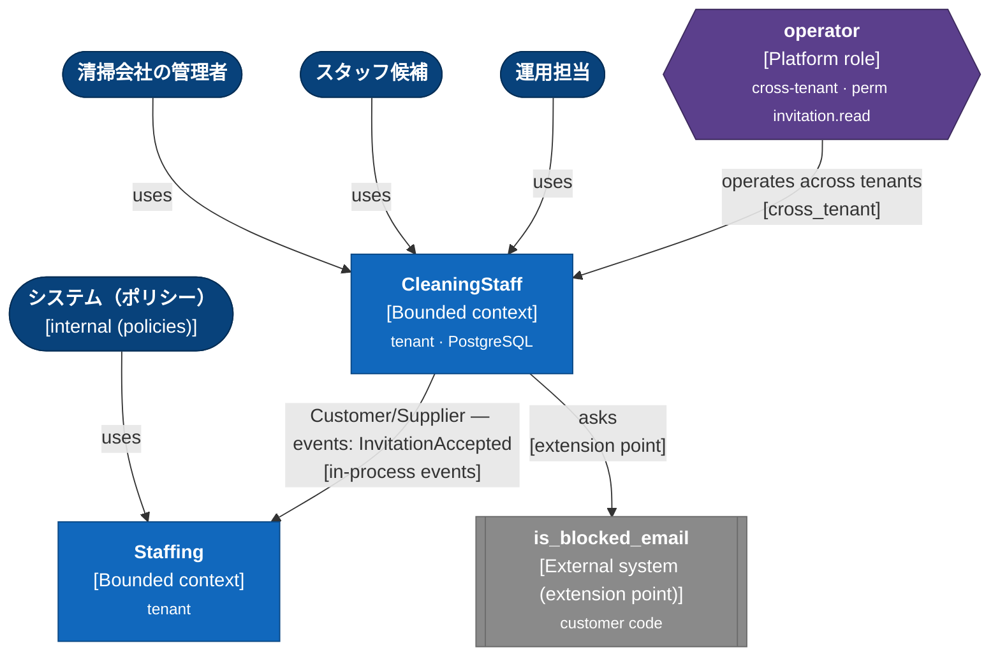
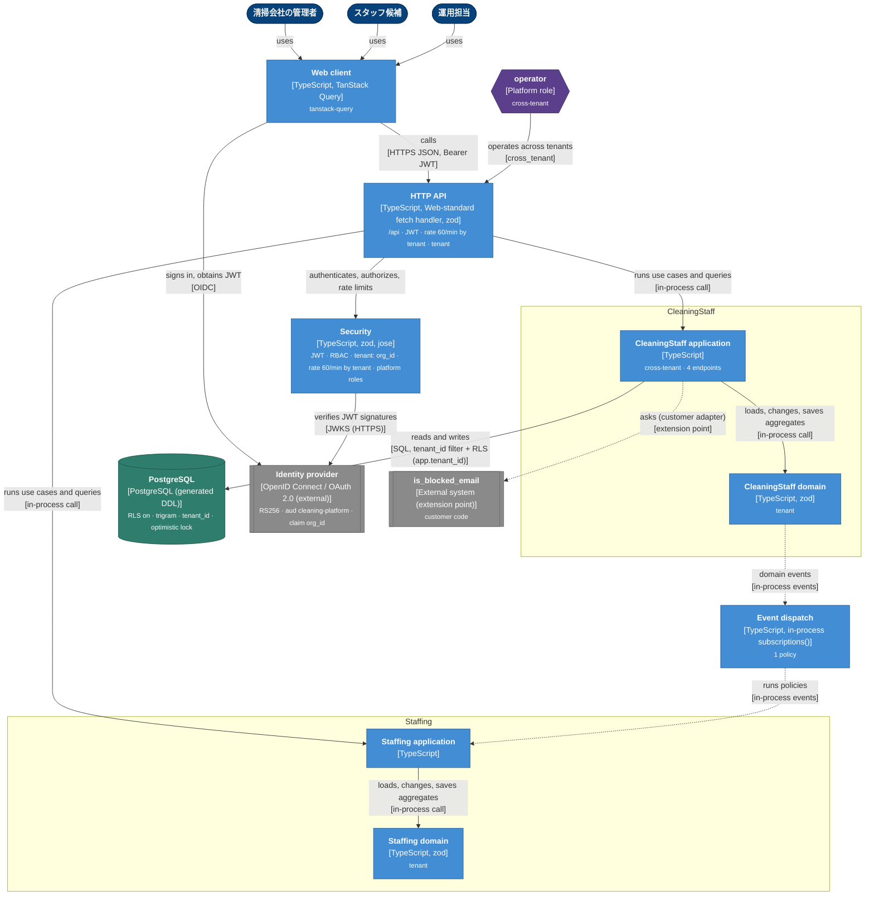
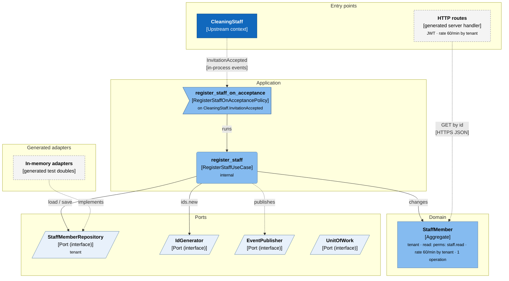

<!-- Generated by DDD Presenter from model "cleaning-platform". DO NOT EDIT. -->

# Architecture of cleaning-platform

清掃スタッフの招待と受諾を扱うサンプルモデル（TypeScript / Zod で生成）

Derived from the model by `ddd generate` (target: typescript) in the spirit of the C4 model: system context, containers, and the components of each bounded context. The diagrams are Mermaid flowcharts; edit the model, not this file.

## 1. System context

Bounded contexts, the context map, actors and external systems.

| Element | Kind | Technology | Description | Badges |
|---|---|---|---|---|
| 清掃会社の管理者 | Person | — | Runs issue_invitation, revoke_invitation | — |
| スタッフ候補 | Person | — | Runs accept_invitation | — |
| 運用担当 | Person | — | Runs inspect_invitation | — |
| システム（ポリシー） | Person | internal (policies) | Runs register_staff | — |
| operator | Platform role | Platform role | Global role, acts across tenants (cross_tenant use cases only). | `cross-tenant` `perm invitation.read` |
| CleaningStaff | Bounded context | Bounded context | 清掃スタッフの招待・受諾・取り消しを扱う — 1 aggregate, 4 use cases, 1 query | `tenant` `PostgreSQL` |
| Staffing | Bounded context | Bounded context | 招待を受諾した人をスタッフとして登録する（CleaningStaff の下流） — 1 aggregate, 1 use case, 1 policy | `tenant` |
| is_blocked_email | External system | External system (extension point) | 配信停止・ブロック済みのメールアドレスか（顧客実装） | `customer code` |

| From | To | Relationship | Technology |
|---|---|---|---|
| 清掃会社の管理者 | CleaningStaff | uses | — |
| スタッフ候補 | CleaningStaff | uses | — |
| 運用担当 | CleaningStaff | uses | — |
| システム（ポリシー） | Staffing | uses | — |
| operator | CleaningStaff | operates across tenants | cross_tenant |
| CleaningStaff | Staffing | Customer/Supplier — events: InvitationAccepted | in-process events |
| CleaningStaff | is_blocked_email | asks | extension point |

## 2. Containers

What `ddd generate` produces for this model and target, and how the parts talk.

| Element | Kind | Technology | Description | Badges |
|---|---|---|---|---|
| Web client | Container | TypeScript, TanStack Query | Typed query / mutation options for every endpoint (generated client). | `tanstack-query` |
| HTTP API | Container | TypeScript, Web-standard fetch handler, zod | Contract, server routes and error mapping under /api. Authenticates, authorizes and rate limits every request. | `/api` `JWT` `rate 60/min by tenant` `tenant` |
| Security | Container | TypeScript, zod, jose | Principal, roles and permissions, authorization checks, rate limiting, tenant context, bearer JWT authenticator. | `JWT` `RBAC` `tenant: org_id` `rate 60/min by tenant` `platform roles` |
| 清掃会社の管理者 | Person | — | — | — |
| スタッフ候補 | Person | — | — | — |
| 運用担当 | Person | — | — | — |
| operator | Platform role | Platform role | — | `cross-tenant` |
| CleaningStaff application | Container | TypeScript | 4 use cases, 1 query; ports for repositories and extensions. | `cross-tenant` `4 endpoints` |
| CleaningStaff domain | Container | TypeScript, zod | 1 aggregate, value objects, invariants, state guards and domain events. | `tenant` |
| Staffing application | Container | TypeScript | 1 use case, 1 policy; ports for repositories and extensions. | — |
| Staffing domain | Container | TypeScript, zod | 1 aggregate, value objects, invariants, state guards and domain events. | `tenant` |
| Event dispatch | Container | TypeScript, in-process subscriptions() | Policies subscribe to domain events and run use cases (wire subscriptions() into your event bus). | `1 policy` |
| PostgreSQL | Database | PostgreSQL (generated DDL) | One table per aggregate of CleaningStaff; keyset paging, pg_trgm GIN indexes, tenant_id on tenant-scoped tables; optimistic locking (version). | `RLS on` `trigram` `tenant_id` `optimistic lock` |
| Identity provider | Identity provider | OpenID Connect / OAuth 2.0 (external) | Issues the bearer JWTs (iss https://auth.example.com/); signing keys from its JWKS. | `RS256` `aud cleaning-platform` `claim org_id` |
| is_blocked_email | External system | External system (extension point) | 配信停止・ブロック済みのメールアドレスか（顧客実装） | `customer code` |

| From | To | Relationship | Technology |
|---|---|---|---|
| 清掃会社の管理者 | Web client | uses | — |
| スタッフ候補 | Web client | uses | — |
| 運用担当 | Web client | uses | — |
| Web client | HTTP API | calls | HTTPS JSON, Bearer JWT |
| Web client | Identity provider | signs in, obtains JWT | OIDC |
| HTTP API | Security | authenticates, authorizes, rate limits | — |
| operator | HTTP API | operates across tenants | cross_tenant |
| HTTP API | CleaningStaff application | runs use cases and queries | in-process call |
| CleaningStaff application | CleaningStaff domain | loads, changes, saves aggregates | in-process call |
| CleaningStaff application | PostgreSQL | reads and writes | SQL, tenant_id filter + RLS (app.tenant_id) |
| CleaningStaff application | is_blocked_email | asks (customer adapter) | extension point |
| CleaningStaff domain | Event dispatch | domain events | in-process events |
| HTTP API | Staffing application | runs use cases and queries | in-process call |
| Staffing application | Staffing domain | loads, changes, saves aggregates | in-process call |
| Event dispatch | Staffing application | runs policies | in-process events |
| Security | Identity provider | verifies JWT signatures | JWKS (HTTPS) |

## 3.1 Components of CleaningStaff

清掃スタッフの招待・受諾・取り消しを扱う — 1 aggregate, 4 use cases, 1 query

```mermaid
flowchart TB
  subgraph n_grp_entry["Entry points"]
    n_cmp_CleaningStaff_adapter_http["<b>HTTP routes</b><br/>[generated server handler]<br/><small>JWT · rate 60/min by tenant</small>"]
  end
  subgraph n_grp_application["Application"]
    n_cmp_CleaningStaff_uc_issue_invitation("<b>issue_invitation</b><br/>[IssueInvitationUseCase]<br/><small>perms: invitation.issue · rate 10/min by tenant</small>")
    n_cmp_CleaningStaff_uc_accept_invitation("<b>accept_invitation</b><br/>[AcceptInvitationUseCase]<br/><small>perms: invitation.accept + allow_if · rate 5/min by principal</small>")
    n_cmp_CleaningStaff_uc_revoke_invitation("<b>revoke_invitation</b><br/>[RevokeInvitationUseCase]<br/><small>perms: invitation.revoke · rate 60/min by tenant</small>")
    n_cmp_CleaningStaff_uc_inspect_invitation("<b>inspect_invitation</b><br/>[InspectInvitationUseCase]<br/><small>perms: invitation.read · cross-tenant · rate 60/min by tenant · no transaction</small>")
    n_cmp_CleaningStaff_query_search_invitations("<b>search_invitations</b><br/>[SearchInvitationsQuery]<br/><small>trigram · page 20/100 · perms: invitation.list · rate 60/min by tenant</small>")
  end
  subgraph n_grp_domain["Domain"]
    n_cmp_CleaningStaff_agg_CleaningStaffInvitation["<b>CleaningStaffInvitation</b><br/>[Aggregate]<br/><small>tenant · read: perms: invitation.read, invitation.accept + allow_if · rate 60/min by tenant · 3 operations</small>"]
  end
  subgraph n_grp_ports["Ports"]
    n_cmp_CleaningStaff_port_CleaningStaffInvitationRepository[/"<b>CleaningStaffInvitationRepository</b><br/>[Port (interface)]<br/><small>tenant · optimistic lock</small>"/]
    n_cmp_CleaningStaff_port_SearchInvitationsReader[/"<b>SearchInvitationsReader</b><br/>[Port (interface)]<br/><small>trigram · keyset paging</small>"/]
    n_cmp_CleaningStaff_port_Extensions[/"<b>Extensions</b><br/>[Port (interface)]"/]
    n_cmp_CleaningStaff_port_Clock[/"<b>Clock</b><br/>[Port (interface)]"/]
    n_cmp_CleaningStaff_port_IdGenerator[/"<b>IdGenerator</b><br/>[Port (interface)]"/]
    n_cmp_CleaningStaff_port_EventPublisher[/"<b>EventPublisher</b><br/>[Port (interface)]"/]
    n_cmp_CleaningStaff_port_UnitOfWork[/"<b>UnitOfWork</b><br/>[Port (interface)]"/]
    n_cmp_CleaningStaff_port_CrossTenantAudit[/"<b>CrossTenantAudit</b><br/>[Port (interface)]<br/><small>audit</small>"/]
  end
  subgraph n_grp_adapters["Generated adapters"]
    n_ext_CleaningStaff_is_blocked_email[["<b>is_blocked_email</b><br/>[External system]<br/><small>customer code</small>"]]
    n_cmp_CleaningStaff_adapter_memory["<b>In-memory adapters</b><br/>[generated test doubles]"]
    n_cmp_CleaningStaff_adapter_postgres["<b>PostgreSQL adapters</b><br/>[generated repositories and readers]<br/><small>RLS · trigram</small>"]
    n_ctr_postgres[("<b>PostgreSQL</b><br/>[PostgreSQL]<br/><small>RLS on · trigram</small>")]
    n_cmp_CleaningStaff_adapter_extensions["<b>Customer extensions</b><br/>[scaffold (customer-owned)]"]
  end
  n_cmp_CleaningStaff_adapter_http -->|"POST<br/>[HTTPS JSON]"| n_cmp_CleaningStaff_uc_issue_invitation
  n_cmp_CleaningStaff_uc_issue_invitation -->|"changes"| n_cmp_CleaningStaff_agg_CleaningStaffInvitation
  n_cmp_CleaningStaff_uc_issue_invitation -->|"load / save"| n_cmp_CleaningStaff_port_CleaningStaffInvitationRepository
  n_cmp_CleaningStaff_uc_issue_invitation -->|"clock.now"| n_cmp_CleaningStaff_port_Clock
  n_cmp_CleaningStaff_uc_issue_invitation -->|"ids.new"| n_cmp_CleaningStaff_port_IdGenerator
  n_cmp_CleaningStaff_uc_issue_invitation -->|"is_blocked_email"| n_cmp_CleaningStaff_port_Extensions
  n_cmp_CleaningStaff_uc_issue_invitation -.->|"publishes"| n_cmp_CleaningStaff_port_EventPublisher
  n_cmp_CleaningStaff_adapter_http -->|"POST<br/>[HTTPS JSON]"| n_cmp_CleaningStaff_uc_accept_invitation
  n_cmp_CleaningStaff_uc_accept_invitation -->|"changes"| n_cmp_CleaningStaff_agg_CleaningStaffInvitation
  n_cmp_CleaningStaff_uc_accept_invitation -->|"load / save"| n_cmp_CleaningStaff_port_CleaningStaffInvitationRepository
  n_cmp_CleaningStaff_uc_accept_invitation -->|"clock.now"| n_cmp_CleaningStaff_port_Clock
  n_cmp_CleaningStaff_uc_accept_invitation -.->|"publishes"| n_cmp_CleaningStaff_port_EventPublisher
  n_cmp_CleaningStaff_adapter_http -->|"POST<br/>[HTTPS JSON]"| n_cmp_CleaningStaff_uc_revoke_invitation
  n_cmp_CleaningStaff_uc_revoke_invitation -->|"changes"| n_cmp_CleaningStaff_agg_CleaningStaffInvitation
  n_cmp_CleaningStaff_uc_revoke_invitation -->|"load / save"| n_cmp_CleaningStaff_port_CleaningStaffInvitationRepository
  n_cmp_CleaningStaff_uc_revoke_invitation -.->|"publishes"| n_cmp_CleaningStaff_port_EventPublisher
  n_cmp_CleaningStaff_adapter_http -->|"POST<br/>[HTTPS JSON]"| n_cmp_CleaningStaff_uc_inspect_invitation
  n_cmp_CleaningStaff_uc_inspect_invitation -->|"reads"| n_cmp_CleaningStaff_agg_CleaningStaffInvitation
  n_cmp_CleaningStaff_uc_inspect_invitation -->|"load"| n_cmp_CleaningStaff_port_CleaningStaffInvitationRepository
  n_cmp_CleaningStaff_uc_inspect_invitation -->|"records access"| n_cmp_CleaningStaff_port_CrossTenantAudit
  n_cmp_CleaningStaff_adapter_http -->|"GET<br/>[HTTPS JSON]"| n_cmp_CleaningStaff_query_search_invitations
  n_cmp_CleaningStaff_query_search_invitations -->|"reads a page"| n_cmp_CleaningStaff_port_SearchInvitationsReader
  n_cmp_CleaningStaff_adapter_http -.->|"GET by id<br/>[HTTPS JSON]"| n_cmp_CleaningStaff_agg_CleaningStaffInvitation
  n_cmp_CleaningStaff_adapter_extensions -.->|"calls"| n_ext_CleaningStaff_is_blocked_email
  n_cmp_CleaningStaff_adapter_memory -.->|"implements"| n_cmp_CleaningStaff_port_CleaningStaffInvitationRepository
  n_cmp_CleaningStaff_adapter_postgres -.->|"implements"| n_cmp_CleaningStaff_port_CleaningStaffInvitationRepository
  n_cmp_CleaningStaff_adapter_postgres -.->|"implements"| n_cmp_CleaningStaff_port_SearchInvitationsReader
  n_cmp_CleaningStaff_adapter_postgres -->|"SQL<br/>[SQL, tenant_id + RLS]"| n_ctr_postgres
  n_cmp_CleaningStaff_adapter_extensions -.->|"implements"| n_cmp_CleaningStaff_port_Extensions
  classDef person fill:#08427b,stroke:#052e56,color:#fff
  classDef role fill:#5b3f8c,stroke:#3d2a5e,color:#fff
  classDef context fill:#1168bd,stroke:#0b4884,color:#fff
  classDef container fill:#438dd5,stroke:#2e6295,color:#fff
  classDef database fill:#2f7d6d,stroke:#1f5449,color:#fff
  classDef external fill:#8a8a8a,stroke:#6b6b6b,color:#fff
  classDef component fill:#85bbf0,stroke:#5d82a8,color:#000
  classDef port fill:#e8f1fb,stroke:#5d82a8,color:#000
  classDef adapter fill:#f4f4f4,stroke:#8a8a8a,color:#000,stroke-dasharray:4 3
  class n_cmp_CleaningStaff_adapter_http,n_cmp_CleaningStaff_adapter_memory,n_cmp_CleaningStaff_adapter_postgres,n_cmp_CleaningStaff_adapter_extensions adapter
  class n_cmp_CleaningStaff_uc_issue_invitation,n_cmp_CleaningStaff_uc_accept_invitation,n_cmp_CleaningStaff_uc_revoke_invitation,n_cmp_CleaningStaff_uc_inspect_invitation,n_cmp_CleaningStaff_query_search_invitations,n_cmp_CleaningStaff_agg_CleaningStaffInvitation component
  class n_cmp_CleaningStaff_port_CleaningStaffInvitationRepository,n_cmp_CleaningStaff_port_SearchInvitationsReader,n_cmp_CleaningStaff_port_Extensions,n_cmp_CleaningStaff_port_Clock,n_cmp_CleaningStaff_port_IdGenerator,n_cmp_CleaningStaff_port_EventPublisher,n_cmp_CleaningStaff_port_UnitOfWork,n_cmp_CleaningStaff_port_CrossTenantAudit port
  class n_ext_CleaningStaff_is_blocked_email external
  class n_ctr_postgres database
```

| Element | Kind | Technology | Description | Badges |
|---|---|---|---|---|
| HTTP routes | Adapter | generated server handler | 4 use case endpoints, 1 GET by id, 1 query endpoints. | `JWT` `rate 60/min by tenant` |
| issue_invitation | Use case | IssueInvitationUseCase | スタッフ候補へ招待を発行する | `perms: invitation.issue` `rate 10/min by tenant` |
| accept_invitation | Use case | AcceptInvitationUseCase | 招待を受諾する | `perms: invitation.accept + allow_if` `rate 5/min by principal` |
| revoke_invitation | Use case | RevokeInvitationUseCase | — | `perms: invitation.revoke` `rate 60/min by tenant` |
| inspect_invitation | Use case | InspectInvitationUseCase | — | `perms: invitation.read` `cross-tenant` `rate 60/min by tenant` `no transaction` |
| search_invitations | Query | SearchInvitationsQuery | 招待をメールアドレスで探す（似ている順）。状態と作成日時で絞り込める | `trigram` `page 20/100` `perms: invitation.list` `rate 60/min by tenant` |
| CleaningStaffInvitation | Aggregate | Aggregate | スタッフ候補への招待 | `tenant` `read: perms: invitation.read, invitation.accept + allow_if` `rate 60/min by tenant` `3 operations` |
| CleaningStaffInvitationRepository | Port | Port (interface) | Loads and stores CleaningStaffInvitation of one tenant at a time. | `tenant` `optimistic lock` |
| SearchInvitationsReader | Port | Port (interface) | Reads pages of CleaningStaffInvitation for search_invitations. | `trigram` `keyset paging` |
| Extensions | Port | Port (interface) | Customer-implemented: is_blocked_email. | — |
| Clock | Port | Port (interface) | Current time (clock.now). | — |
| IdGenerator | Port | Port (interface) | New identifiers (ids.new). | — |
| EventPublisher | Port | Port (interface) | Publishes domain events (after commit when asked). | — |
| UnitOfWork | Port | Port (interface) | Transaction boundary of a use case. | — |
| CrossTenantAudit | Port | Port (interface) | Audits cross-tenant access by platform roles. | `audit` |
| is_blocked_email | External system | External system | 配信停止・ブロック済みのメールアドレスか（顧客実装） | `customer code` |
| In-memory adapters | Adapter | generated test doubles | Repositories, clock, ids and publisher for tests and prototypes. | — |
| PostgreSQL adapters | Adapter | generated repositories and readers | SQL repositories (optimistic locking) and query readers (keyset paging). | `RLS` `trigram` |
| PostgreSQL | Database | PostgreSQL | — | `RLS on` `trigram` |
| Customer extensions | Adapter | scaffold (customer-owned) | Implements the extension points and translators; never overwritten. | — |

| From | To | Relationship | Technology |
|---|---|---|---|
| HTTP routes | issue_invitation | POST | HTTPS JSON |
| issue_invitation | CleaningStaffInvitation | changes | — |
| issue_invitation | CleaningStaffInvitationRepository | load / save | — |
| issue_invitation | Clock | clock.now | — |
| issue_invitation | IdGenerator | ids.new | — |
| issue_invitation | Extensions | is_blocked_email | — |
| issue_invitation | EventPublisher | publishes | — |
| HTTP routes | accept_invitation | POST | HTTPS JSON |
| accept_invitation | CleaningStaffInvitation | changes | — |
| accept_invitation | CleaningStaffInvitationRepository | load / save | — |
| accept_invitation | Clock | clock.now | — |
| accept_invitation | EventPublisher | publishes | — |
| HTTP routes | revoke_invitation | POST | HTTPS JSON |
| revoke_invitation | CleaningStaffInvitation | changes | — |
| revoke_invitation | CleaningStaffInvitationRepository | load / save | — |
| revoke_invitation | EventPublisher | publishes | — |
| HTTP routes | inspect_invitation | POST | HTTPS JSON |
| inspect_invitation | CleaningStaffInvitation | reads | — |
| inspect_invitation | CleaningStaffInvitationRepository | load | — |
| inspect_invitation | CrossTenantAudit | records access | — |
| HTTP routes | search_invitations | GET | HTTPS JSON |
| search_invitations | SearchInvitationsReader | reads a page | — |
| HTTP routes | CleaningStaffInvitation | GET by id | HTTPS JSON |
| Customer extensions | is_blocked_email | calls | — |
| In-memory adapters | CleaningStaffInvitationRepository | implements | — |
| PostgreSQL adapters | CleaningStaffInvitationRepository | implements | — |
| PostgreSQL adapters | SearchInvitationsReader | implements | — |
| PostgreSQL adapters | PostgreSQL | SQL | SQL, tenant_id + RLS |
| Customer extensions | Extensions | implements | — |

## 3.2 Components of Staffing

招待を受諾した人をスタッフとして登録する（CleaningStaff の下流） — 1 aggregate, 1 use case, 1 policy

| Element | Kind | Technology | Description | Badges |
|---|---|---|---|---|
| HTTP routes | Adapter | generated server handler | 0 use case endpoints, 1 GET by id, 0 query endpoints. | `JWT` `rate 60/min by tenant` |
| CleaningStaff | Bounded context | Upstream context | — | — |
| register_staff | Use case | RegisterStaffUseCase | 招待を受諾した人をスタッフとして登録する | `internal` |
| register_staff_on_acceptance | Policy | RegisterStaffOnAcceptancePolicy | 招待が受諾されたらスタッフとして登録する | `on CleaningStaff.InvitationAccepted` |
| StaffMember | Aggregate | Aggregate | 登録済みのスタッフ | `tenant` `read: perms: staff.read` `rate 60/min by tenant` `1 operation` |
| StaffMemberRepository | Port | Port (interface) | Loads and stores StaffMember of one tenant at a time. | `tenant` |
| IdGenerator | Port | Port (interface) | New identifiers (ids.new). | — |
| EventPublisher | Port | Port (interface) | Publishes domain events (after commit when asked). | — |
| UnitOfWork | Port | Port (interface) | Transaction boundary of a use case. | — |
| In-memory adapters | Adapter | generated test doubles | Repositories, clock, ids and publisher for tests and prototypes. | — |

| From | To | Relationship | Technology |
|---|---|---|---|
| register_staff | StaffMember | changes | — |
| register_staff | StaffMemberRepository | load / save | — |
| register_staff | IdGenerator | ids.new | — |
| register_staff | EventPublisher | publishes | — |
| HTTP routes | StaffMember | GET by id | HTTPS JSON |
| CleaningStaff | register_staff_on_acceptance | InvitationAccepted | in-process events |
| register_staff_on_acceptance | register_staff | runs | — |
| In-memory adapters | StaffMemberRepository | implements | — |
